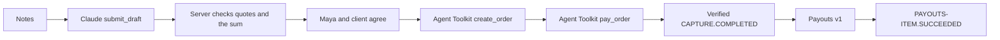

# Hire

The job page where a client payment becomes Maya’s payout.

The model drafts the agreement. **It cannot move money it cannot cite.** Every amount in a model draft must quote a note on the job. The server checks that the quote is in that job’s messages and that the client amount equals Maya’s share plus the studio remainder. PayPal is called only after Maya and the client agree, and only with the amounts stored on the job row. Paid status exists only when a real PayPal sandbox id is stored.

If `ANTHROPIC_API_KEY` is missing or the model request fails, a labeled parser reads the notes instead. The job page says **Parsed from notes, not a model.** That parser is not the model.

Built for the [PayPal AI Hackathon](https://paypalaihackathon.devpost.com/).

Live (Render): [https://hire-brjt.onrender.com](https://hire-brjt.onrender.com)

Health SHA: [`d2e5f9b1818050807bd7483d0b94415991e7f3d2`](https://hire-brjt.onrender.com/api/health). The home page opens a **new job** (unique PayPal request ids) so each reviewer can start clean. A new row stores no $1,200 / $800 / $400 until a cited draft is ready.

### One job, draft through payout

[hire-b6678486-44d2-4b3b-a84f-c46fbad12be1](https://hire-brjt.onrender.com/jobs/hire-b6678486-44d2-4b3b-a84f-c46fbad12be1) — drafted by `claude-sonnet-5-5` (validation `pass`, 7.4s). Split $1,200 / $800 / $400, each quoted from the notes. Order `3AR43283AW825772L`. Capture `7CN781661U7159137` (`PAYMENT.CAPTURE.COMPLETED`). Maya payout item `D37YDXNDFJAPA` (`PAYMENT.PAYOUTS-ITEM.SUCCEEDED`).

### Where the model refuses

- Ambiguous notes ($1,200 studio quote vs $1,000 client budget): [hire-1ba7264c-…](https://hire-brjt.onrender.com/jobs/hire-1ba7264c-b5a9-4952-8c85-2ead93bc1790) — `needs_clarification`, amounts stay blank, PayPal stays closed.
- Agreement drift (after both agreed, a note asked for $1,100): [hire-e2288b05-…](https://hire-brjt.onrender.com/jobs/hire-e2288b05-e861-4787-ac9e-a458817302f1) — both agreements cleared, amounts blanked, PayPal stays closed.

## What it does

1. Notes are stored per job. **Draft agreement from notes** calls Claude (`ANTHROPIC_MODEL`, default `claude-sonnet-5-5`) through `POST https://api.anthropic.com/v1/messages` and the `submit_draft` tool. The tool returns a work summary, three amounts, a quote (`messageId` + exact text) for each figure, or clarification questions. The studio remainder may be calculated as client minus Maya. The server rejects a quote that is not in `job_messages`, then asks the model once more. If it still cannot cite, the job stays `needs_clarification` and the PayPal amounts on the row are not replaced. Each run is stored in `ai_runs` (model, latency, token counts, validation) and shown on the page. A new note that names a different amount after someone has agreed clears both agreements until the next draft is accepted.
2. Maya and the client agree on the stored numbers. Agreement and order are refused until `agreement_status` is `ready` and `agreement_version` is at least 1. A new job stores no PayPal amounts until that draft. Ambiguous notes stay `needs_clarification`. A later note with a new dollar amount is agreement drift and clears both agreements.
3. After both parties agree, the server calls PayPal Agent Toolkit `create_order` with `jobs.client_amount`. The model does not pass the amount. `PayPal-Request-Id` is `${jobId}-order`.
4. After the client approves, the server captures with Agent Toolkit `pay_order`.
5. Only after a verified `PAYMENT.CAPTURE.COMPLETED` webhook, and only if the capture is the stored order for the stored client amount, does the server send a Payouts v1 payment of `jobs.maya_amount` to Maya’s sandbox email. The toolkit has no payouts tool.
6. `PAYMENT.PAYOUTS-ITEM.SUCCEEDED` closes Maya’s share when the payout item amount matches. The job still shows the studio remainder.

The demo thread that produces a cited draft is client **$1,200**, Maya **$800**, studio **$400**. A new job row stores no amounts until that draft is ready. Copy then reads the stored fields. Client, Maya, and studio amounts must each be greater than zero.



Demo video: [Hire on YouTube](https://youtu.be/cRNUUstOpYk) (2:47).

Screenshots: the job page before a draft (amounts blank) and after capture (PayPal ids on the timeline).

## PayPal APIs

Sandbox only (`https://api-m.sandbox.paypal.com`).

| Step | How |
| --- | --- |
| Create order | PayPal Agent Toolkit `create_order` ([agent tools](https://developer.paypal.com/ai-tools/agent-tools); amount from the job row) |
| Capture | PayPal Agent Toolkit `pay_order` |
| Verify webhook | `POST /v1/notifications/verify-webhook-signature` |
| Pay Maya | `POST /v1/payments/payouts` (`PayPal-Request-Id` and `sender_batch_id` from the job id) |

`platform_fees` is not used. In sandbox that fee does not appear in the balance, so it cannot be shown to judges.

## Try the sandbox

1. Open the live URL. It creates a new job. If the first request is slow, wait; a keep-alive hits `/api/health`.
2. Use **Example** for a cited $1,200 / $800 / $400 draft, or **Ambiguous example** for two client prices that stay `needs_clarification`. Then **Draft agreement from notes**. After both parties agree, a note with a new dollar amount is agreement drift.
3. Record Maya and client agreement.
4. Pay with a PayPal **sandbox** buyer account. This repo does not ship buyer passwords.
5. Capture, then wait for the capture webhook and Maya’s payout item id.

## Local

```bash
cp .env.example .env
docker compose up -d db
npm install
npm run db:migrate
npm run dev
```

Tests: `npm run test:webhooks` (13 cases), `npm run test:agreement` (17 cases). Requires local Postgres with `DATABASE_URL`.

Open [http://127.0.0.1:3000/](http://127.0.0.1:3000/).

Required in `.env`: `PAYPAL_CLIENT_ID`, `PAYPAL_CLIENT_SECRET`, `PAYPAL_API_BASE`, `PAYPAL_MAYA_EMAIL`, `PAYPAL_WEBHOOK_ID`, `DATABASE_URL`, `APP_ORIGIN`, and `ANTHROPIC_API_KEY`. Optional: `ANTHROPIC_MODEL` (default `claude-sonnet-5-5`). Never commit `.env`. `PAYPAL_API_BASE` is `https://api-m.sandbox.paypal.com`. On Render, `APP_ORIGIN` can be `RENDER_EXTERNAL_URL`.

For local webhooks, expose `/api/webhooks/paypal` over HTTPS, then:

```bash
node scripts/subscribe-webhook.mjs https://your-https-host
```

Put the printed `webhookId` in `PAYPAL_WEBHOOK_ID`.

## License

MIT. See [LICENSE](LICENSE).
